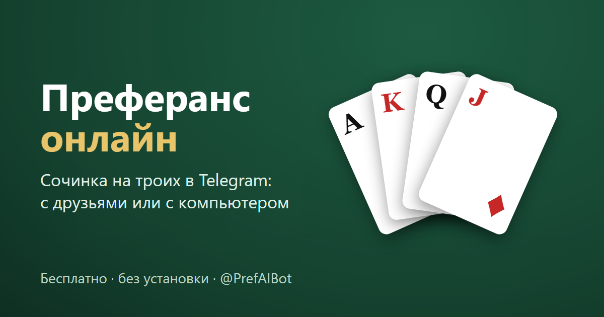

<div align="center">



# Преферанс «Сочинка» в Telegram

**Классическая пуля на троих прямо в Telegram: с друзьями в группе под видеозвонок или против ИИ четырёх уровней. Бесплатно, без установки и без рекламы.**

[](https://t.me/PrefAIBot?start=github)
[](https://artemshaer.ru/)
[](https://shaerware.github.io/preferans/)
[](https://github.com/ShaerWare/preferans/actions/workflows/ci.yml)


[Правила сочинки](https://artemshaer.ru/pravila/) · [Калькулятор пули](https://artemshaer.ru/kalkulyator/) · [Игра с компьютером](https://artemshaer.ru/s-kompyuterom/)

</div>

---

Игра открывается из группового чата, а чат, голосовые, видеозвонки, стикеры и реакции остаются настоящими телеграмовскими: пока идёт партия, видеочат группы не прерывается. Не хватает третьего — его место займёт бот, который не подглядывает в чужие карты.

## Возможности

- 🃏 **Полная «Сочинка»**: торговля, прикуп и снос, ответственный вист и полвиста, мизер, распасы, «без трёх», предложения и роспись пули.
- ⚙️ **Настройки стола** под правила вашей компании: выход с распасов (6, 7, прогрессии), цена взятки на распасах, «Сталинград».
- 🤖 **ИИ четырёх уровней**, от новичка до мастера. Мастер перед каждым ходом разыгрывает 36 возможных раскладов.
- 👥 **Игра в группе под видеозвонок**: чат стола синхронизирован с группой в обе стороны, есть реакции над игроками.
- 🏆 **Статистика и рейтинг** по аккаунту Telegram: доигранные и брошенные пули, сумма вистов.
- 🔒 **Честная игра**: все ходы проверяет сервер, клиент видит только свои карты и открытые по правилам.
- 🪶 **Минимум зависимостей**: сервер на Node.js с одной библиотекой `ws`, клиент на чистом JS без сборки.

## Как это устроено

```
Группа в Telegram (3 игрока + бот)
 ├─ чат, голосовые, видеочат группы — сам Telegram
 ├─ бот: /newgame → кнопка «Играть», анонсы заказов и итогов раздач
 └─ Mini App (эта игра) ── WebSocket ──► сервер Node.js
                                          ├─ движок «Сочинки» (server/engine.js)
                                          ├─ столы и чат стола (server/tables.js)
                                          └─ бот на long polling (server/telegram.js)
```

- **Сервер решает всё**: клиент видит только свои карты (и открытые по правилам), ходы проверяются на сервере.
- **Чат стола** внутри игры синхронизирован с группой в обе стороны: сообщения из игры бот дублирует в группу, сообщения из группы видны в игре (значок ✈).
- **Звонок**: когда в группе начинается видеочат, в игре появляется баннер «присоединиться»; кнопка 📞 открывает группу.
- **Реакции** 👍😂🔥… всплывают над игроком.
- Состояние столов сохраняется в `data/tables.json`, так что после перезапуска сервера партия продолжается.

## ИИ-соперники

Если не хватает игроков, свободные места занимают боты. Есть четыре уровня:

| Уровень | Как играет | Средний итог за пулю до 20* |
|---|---|---|
| Новичок | ошибается в оценке руки (зарывается или трусит), часто ходит наугад | −454 |
| Любитель | разумные правила, но не запоминает вышедшие карты | −58 |
| Профи | считает вышедшие карты, аккуратно заказывает и вистует | +187 |
| Мастер | перед каждым ходом разыгрывает 36 возможных раскладов скрытых карт и выбирает лучший ход | +325 |

\* турнир всех уровней друг с другом, 144 пули. Ход мастера занимает в среднем около 7 мс.

Бот видит только то, что видел бы человек на его месте: свою руку, открытые карты, прикуп и вышедшие карты. Ещё он замечает, у кого кончилась масть. Чужие закрытые карты бот не подглядывает.

- **«🤖 Сыграть с ИИ»**: одному против двух ботов, сразу.
- **В лобби**: «🤖 + ИИ» на свободное место или «Добавить ИИ на свободные места и начать».
- **Посреди партии**: если игрок пропал из сети дольше 20 с, остальные могут нажать «🤖 Заменить ИИ». Можно и самому нажать «☕ Отойти», и ИИ будет играть за вас. «Вернуть управление» возвращает место человеку.

## Статистика и рейтинг (🏆)

Сохраняется по аккаунту Telegram (`data/tables-players.json`, в docker-томе), видна всем: своя, игроков за столом и общий рейтинг по вистам.

- **Доиграно** — пуля закрыта, и в конце игрок играл сам.
- **Брошено** — закончил досрочно, ушёл и к концу за него играл ИИ, или пуля простояла больше суток без ходов.
- **Висты** — сумма итогов всех пуль: выигрыш прибавляется, проигрыш вычитается (брошенная по таймауту — без вистов).
- Боты в статистику не входят.

После конца пули — «🏠 В общее меню» (место освобождается) или «🔁 Ещё пулю этим же составом».

## Правила (что реализовано)

| | |
|---|---|
| Колода | 32 карты, по 10, прикуп 2 |
| Торговля | с 6♠, старшинство ♠ ♣ ♦ ♥ БК; только повышение; спасовавший выбывает |
| Мизер | только первым словом; перебивается лишь девятерной; мизерист, которого перебили, выбывает |
| Игра | играющий берёт прикуп (его видят все), сносит 2 и заказывает не меньше выигранного |
| Вист | ответственный; обязательства 6→4, 7→2, 8→1, 9→1, 10→0; «уйти за полвиста» на шестерной и семерной — второй вистующий, если первый спасовал (первый может передумать и вистовать) |
| Один вистующий | выбирает «в открытую» (карты обоих защитников открыты, играет за обоих) или «в закрытую» |
| Мизер | ловящие по очереди решают, кто ловит («Ловлю сам» / «Пусть ловит …»; отказались оба — ловит первый); ловящий ходит за обе руки и сразу видит карты напарника; играющему карты ловящих открываются после первой взятки |
| Распасы | первые две взятки — в масть карт прикупа; взятка 1 в гору, но взятки, которые взяли все трое, не пишутся (3, 3 и 4 → в гору только 1 тому, у кого 4); без взяток +1 в пулю |
| Выход с распасов | настройка стола: **6** (без ограничений), **7** (после распасов — с 7♠), прогрессия **7 → 8 → 9** или **7 → 8 → 8** по числу распасов подряд; несыгранная игра (без N, пойманный мизер, без трёх) распасы не прерывает — следующая раздача с того же уровня; после сыгранной игры — снова с 6; мизер можно всегда |
| Цена взятки на распасах | настройка стола: **1, 1, 1…**, **1, 2, 2…** или **1, 2, 4…** по кругам распасов подряд; при выборе выхода подставляется сама (6 → 1,1,1; 7 → 1,2,2; прогрессии → 1,2,4), можно поменять; после сыгранной игры снова 1 (несыгранная не сбрасывает). На одинарных распасах (1, 1, 1…) за 0 взяток в пулю пишется по выходу: с 6 — 1, с 7 — 2, с 8 и выше — 4 |
| Сталинград (обязон) | настройка стола: если включён, на 6♠ вистуют оба обязательно, в закрытую; за недовист отвечают как обычно |
| Стоимость | 6=2, 7=4, 8=6, 9=8, 10=10, мизер=10 |
| Недобор | гора = стоимость × недобор; оба противника пишут на играющего такие же висты |
| Недовист | стоимость игры за каждую недобранную взятку в гору (6 — 2, 7 — 4, 8 — 6 …) |
| Без трёх | после прикупа играющий может сдаться (кроме мизера): только гора 3 × стоимость (6 → 6, 7 → 12 …), противникам вистов нет |
| Предложить | во время игры или мизера любой предлагает одно число — сколько всего возьмёт играющий («своя игра», «без 1», «+1», «чистый мизер»); его карты открываются; остальные взятки — защите (при двух вистующих поровну, лишняя тому, у кого меньше). При согласии всех раздача считается сразу. На распасах кнопки нет. Боты отвечают, доигрывая возможные расклады |
| Остальные мои | на распасах любой может забрать все оставшиеся взятки себе (со второго нажатия); раздача сразу считается, согласия остальных не нужно |
| Закрытие пули | излишек отдаётся соседям, за помощь — висты (×10) |
| Итог | гора и недописанная пуля переводятся в висты (×10), затем сальдо |

**Спорные места** (в разных компаниях играют по-разному) вынесены в `server/rules.js` → `DEFAULT_CONFIG`:
- на 8 и 9 при двух вистующих за недовист отвечает второй вистующий;
- на распасах, если никто не поддержал масть карты прикупа, взятка не достаётся никому;
- нет «игры без прикупа» и «здесь».

## Запуск локально (без Telegram)

```bash
npm install
npm test                       # движок + сквозной тест (3 клиента играют через сервер)
DEV=1 npm start                # на Windows PowerShell: $env:DEV=1; npm start
```

Откройте `http://localhost:8080/?dev=Аня`, нажмите «Создать стол», затем ещё две вкладки
`?dev=Боря&table=<ID>` и `?dev=Вика&table=<ID>`.

## Подключение к Telegram

1. **@BotFather** → `/newbot` → получите токен.
2. `/newapp` → выберите бота, укажите HTTPS-адрес игры, короткое имя (например `play`).
3. `/setprivacy` → **Disable**, чтобы бот видел сообщения группы (или сделайте бота админом группы).
4. Скопируйте `.env.example` в `.env` и заполните `BOT_TOKEN`, `APP_SHORT_NAME`, `WEBAPP_URL`.
5. Разверните на сервере с HTTPS (Mini App работает только по https):

```nginx
server {
    server_name pref.example.ru;
    location / {
        proxy_pass http://127.0.0.1:8080;
        proxy_http_version 1.1;
        proxy_set_header Upgrade $http_upgrade;     # WebSocket
        proxy_set_header Connection "upgrade";
        proxy_set_header Host $host;
        proxy_read_timeout 3600s;
    }
}
```

Запуск через systemd или `pm2 start server/index.js --name pref`.

## Деплой в Docker

```bash
cp .env.example .env      # BOT_TOKEN, APP_SHORT_NAME, WEBAPP_URL
docker compose up -d --build
```

- Контейнер слушает `127.0.0.1:8097`; пример server-блока для nginx с WebSocket — `deploy/nginx/preferans.conf`, TLS выпускает `certbot --nginx`.
- Столы, статистика и учёт источников хранятся в docker-томе `preferans_data` и переживают пересборку.
- `WEBAPP_URL` указывает на `/app`: корень сайта — лендинг, а старые Telegram-ссылки на корень сами уходят в `/app`.
- `.env` хранится только на сервере (`chmod 600`) и в репозиторий не попадает.

Обновление: `git pull && docker compose up -d --build`.

## Как играть

1. Создайте группу с двумя друзьями, добавьте бота.
2. Напишите `/newgame` → нажмите «▶️ Играть» → первые трое садятся.
3. Включите видеочат группы: звонок продолжается, пока открыта игра. Свайпните игру вниз, чтобы свернуть её и написать в чат.
4. `/score` в группе — текущий счёт.

## Структура

```
server/rules.js     константы и настраиваемые правила
server/engine.js    движок: торговля, прикуп, вист, розыгрыш, подсчёт
server/ai.js        ИИ-игроки: оценка руки, вист, снос, розыгрыш (4 уровня)
server/tables.js    столы, посадка, чат, сохранение
server/telegram.js  проверка initData, бот
server/stats.js     статистика игроков и рейтинг
server/index.js     HTTP + WebSocket + обработка команд бота
public/app.html     Mini App (чистый JS, без сборки), открывается по /app
public/index.html   сайт: лендинг, /pravila/, /kalkulyator/, /s-kompyuterom/ (SEO)
test/               тесты движка и сквозной тест
```

## GitHub Pages

Копия лендинга опубликована на [shaerware.github.io/preferans](https://shaerware.github.io/preferans/). Её собирает workflow `.github/workflows/pages.yml` из файлов `public/` при каждом пуше в `main`: пути переписываются под подкаталог `/preferans/`, а `canonical` остаётся на [artemshaer.ru](https://artemshaer.ru/), чтобы поисковики не считали копию дублем.

## Автор

Сделано в [ShaerWare Studio](https://shaerware.github.io/). Вопросы и предложения по правилам — в [Issues](https://github.com/ShaerWare/preferans/issues).
